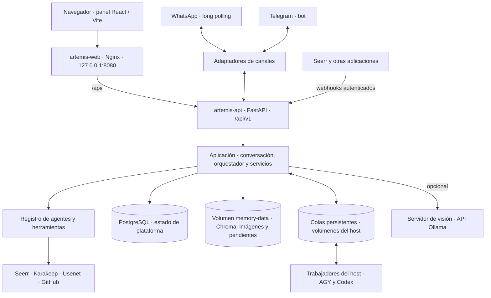
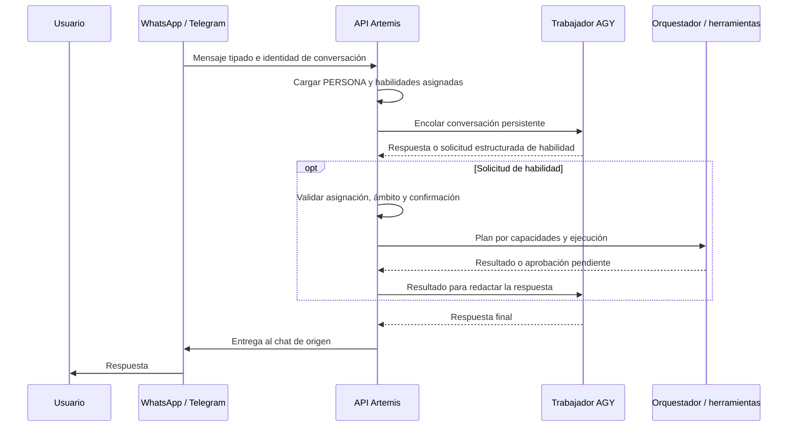

# ARTEMIS

Artemis es una plataforma autohospedada de agentes para un entorno privado. Centraliza conversaciones de WhatsApp y Telegram, habilidades de servicios, memoria y tareas de desarrollo en un panel web en español. Su arquitectura es un **monolito modular**: una API coordina el dominio y la persistencia; los trabajadores de Codex y Antigravity ejecutan las tareas externas al contenedor.

## Arquitectura y despliegue



Nginx sirve la interfaz y reenvía la API. PostgreSQL está en la red interna; la API no publica un puerto del host en el Compose principal. API y web usan sistema de archivos de solo lectura, directorios temporales y capacidades Linux retiradas. Los trabajadores del host tienen un ámbito de permisos distinto al contenedor API.

| Capa | Responsabilidad | Ubicación |
| --- | --- | --- |
| Presentación y canales | Panel, REST, entrada/salida de bots, validación de adjuntos | `frontend/src`, `backend/app/api`, `backend/app/infrastructure` |
| Aplicación | Conversación, selección de habilidades, DAG, aprobaciones, recordatorios y entrega diferida | `backend/app/application` |
| Dominio | Contratos tipados, capacidades, permisos y puertos de servicios | `backend/app/domain` |
| Agentes y herramientas | Implementación de habilidades y ejecución controlada de operaciones | `backend/app/agents`, `backend/app/tools` |
| Infraestructura | PostgreSQL, memoria vectorial, clientes HTTP, cifrado y colas | `backend/app/infrastructure` |
| Trabajadores | Ejecución de CLI y publicación de resultados en la cola compartida | `scripts/` y servicios del host |

### Flujo de una conversación



Los bots usan AGY como motor conversacional predeterminado y mantienen PERSONA e historial por identidad y conversación. El puente permite hasta cuatro acciones por mensaje y vuelve a comprobar las habilidades antes de ejecutarlas. La conversación utiliza un directorio separado y permisos que deniegan herramientas locales; PERSONA no concede permisos.

Las solicitudes REST o con capacidades explícitas conservan el flujo `IncomingMessage → SkillSessionRouter → CapabilityPlanner → ExecutionPlan → DAGExecutor → Agent → ToolRegistry → OutgoingMessage`. El ejecutor procesa nodos disponibles concurrentemente, aplica timeout por agente y recoge resultados y errores. El planificador actual selecciona capacidades; no es un planificador autónomo de propósito general.

## Capacidades actuales del agente

Las integraciones requieren configuración y asignación al bot correspondiente. Que una herramienta figure en el inventario administrativo no significa que cualquier agente pueda ejecutarla.

| Capacidad | Qué permite | Requisitos y límites |
| --- | --- | --- |
| Conversación y PERSONA | Preguntar, pedir ayuda y usar habilidades con lenguaje natural | Trabajador AGY disponible; perfiles y contexto separados por bot/conversación. [Guía](docs/conversation.md) |
| Estado y ayuda | Consultar las capacidades disponibles y el estado del asistente | Agente base `assistant.status` |
| Seerr | Buscar contenido, consultar solicitudes y estados, solicitar películas o series | Servicio configurado y confirmación de operaciones sensibles. [Guía](docs/seerr.md) |
| Karakeep | Buscar marcadores y guardar enlaces | URL/API key; guardar requiere aprobación concreta. [Guía](docs/karakeep.md) |
| Usenet | Buscar en NZBPlanet y gestionar cola, progreso e historial de NZBGet | Ambos servicios configurados; descarga, pausa y reanudación requieren confirmación. [Guía](docs/usenet.md) |
| GitHub | Consultar repositorios, commits, ramas, issues y pull requests | Credenciales y habilidad asignada |
| Codex y Antigravity | Revisar y modificar el proyecto, ejecutar comandos y crear herramientas | Trabajadores instalados y autenticados. El modo de desarrollo opera sobre el proyecto real con permisos amplios del host. [Codex](docs/codex.md) · [Antigravity](docs/antigravity.md) |
| Notificaciones | Enviar avisos y consultar su historial; compartir entrega entre habilidades y webhooks | Canal y destinatario configurados. [Guía](docs/notifications.md) |
| Recordatorios | Programar mensajes por fecha/hora o condición sobre el resultado de una herramienta | Frecuencia de revisión configurable. [Guía](docs/reminders.md) |
| Cerebro y memoria | Buscar, recordar y olvidar información; inspeccionar colecciones, metadatos y embeddings | Aislamiento por agente en herramientas; registro automático de interacciones con cola de reintento. No implica recuperación automática al contexto. [Panel](docs/brain-ui.md) · [Registro](docs/conversation.md#memoria-automática-de-cerebro) |
| Imágenes | Describir imágenes y recuperar referencias de la misma conversación | Motor de visión Ollama configurado; JPEG/PNG/WebP hasta 10 MiB, caducidad de 7 días. Una imagen sola se describe y guarda sin ejecutar habilidades. [Guía](docs/image-ingestion.md) |
| Webhooks | Recibir y conservar eventos de Seerr y otras aplicaciones | Token de ingreso; consulta en Herramientas → Webhooks. [Guía](docs/webhooks.md) |

### Herramientas nativas y minions

Existe una base de function calling con contratos Pydantic/JSON Schema para `memory.search`, `memory.remember` y `memory.forget`. Valida argumentos, capacidades, activación, timeout y aprobaciones de mutaciones. No conecta por sí sola un nuevo bucle LLM a todas las herramientas.

Los minions ejecutan trabajos acotados con concurrencia limitada, timeout y estados consultables desde Cerebro. El destino local está compuesto en la aplicación; existen adaptadores HTTP/SSH, pero requieren workers y configuración confiable adicionales. Su cola e historial son locales al proceso y se pierden al reiniciar. No son agentes autónomos con autoridad adicional. Véase [contratos, ejecución y límites](docs/native-tools-minions.md).

### Curiosidad

Desde WhatsApp o Telegram, Curiosidad monta operaciones de lectura de un documento OpenAPI y las conserva para volver a consultarlas en ese chat. [Consulta los comandos, permisos y formatos admitidos.](docs/curiosity.md)

## Persistencia y límites operativos

- **PostgreSQL:** configuración, identidades y estado persistente de canales y servicios. Los secretos de configuración pueden protegerse con cifrado local o AWS KMS; consulta [KMS y recarga de canales](docs/aws-kms.md).
- **Memoria:** Chroma y archivos en `memory-data`; las interacciones pendientes de embeddings se reintentan fuera del procesamiento del mensaje. La memoria general requiere eliminación explícita; las imágenes siguen su propia caducidad.
- **Trabajos de desarrollo y conversación:** colas compartidas persistentes con los trabajadores del host. La API monta las colas, no las credenciales de autenticación del CLI Codex.
- **Estado local:** algunas selecciones y aprobaciones permanecen en memoria. Reiniciar puede exigir repetir una búsqueda; no se garantiza ejecución exactamente una vez ni coordinación multiproceso para toda operación.

Las habilidades de desarrollo tienen acceso al host según la instalación del trabajador y deben asignarse a conversaciones autorizadas. Sus permisos son independientes de las restricciones del modo conversacional. Consulta [seguridad](docs/security.md) y las guías de cada trabajador para los límites concretos.

## Inicio rápido

Requiere Docker y Docker Compose. El Compose principal conecta la API a la red externa `seerr_default`: debe existir antes del arranque, incluso si aún no configuras esa habilidad.

```bash
cp .env.example .env
# Edita .env: establece POSTGRES_PASSWORD y las integraciones necesarias.
docker network inspect seerr_default >/dev/null 2>&1 || docker network create seerr_default
make up
```

Abre http://127.0.0.1:8080 (o el `WEB_PORT` configurado). El arranque de contenedores no instala los trabajadores del host ni un modelo de visión. Para conversar con los bots, instala Antigravity y configura el canal: [WhatsApp](docs/whatsapp.md), [Telegram](docs/telegram.md) y [conversación natural](docs/conversation.md).

Para un servidor persistente, sigue la [guía de despliegue](docs/deployment.md): configura autenticación administrativa, secretos duraderos, copias de seguridad y acceso autenticado.

## Panel y desarrollo

La interfaz está en español e incluye gestión de agentes, habilidades, herramientas, canales, ajustes y Cerebro. **Ctrl+K** o **⌘+K** permite encontrar secciones. Tema, densidad y movimiento reducido se guardan en el navegador; el diseño se adapta a móvil. La fuente Atkinson Hyperlegible se sirve localmente con su [licencia OFL](frontend/public/fonts/atkinson-hyperlegible/OFL.txt).

| Comando | Uso |
| --- | --- |
| `make setup` | Instalar dependencias locales de backend y frontend |
| `make dev` | Mostrar comandos para iniciar API y frontend en desarrollo |
| `make test` | Pruebas de backend y frontend |
| `make lint` / `make typecheck` | Análisis estático y tipos |
| `make security` / `make eval` | Análisis de seguridad y evaluaciones |
| `make build` / `make up` | Construir imágenes / levantar el entorno |

La API expone `/api/v1/health`, `/api/v1/ready` y `/api/v1/openapi.json`. Los cambios de PERSONA y asignaciones se aplican sin reiniciar canales. Los cambios de código requieren reconstruir los servicios afectados; los scripts de trabajadores requieren actualizar también su copia instalada y esperar al fin de las tareas activas antes de recargarlos.

Documentación adicional: [diseño y contratos](docs/architecture.md), [decisiones de arquitectura](docs/adr), [hoja de ruta](docs/roadmap.md). Estos documentos incluyen propuestas e hitos históricos; este README resume el runtime actual y señala sus límites.
